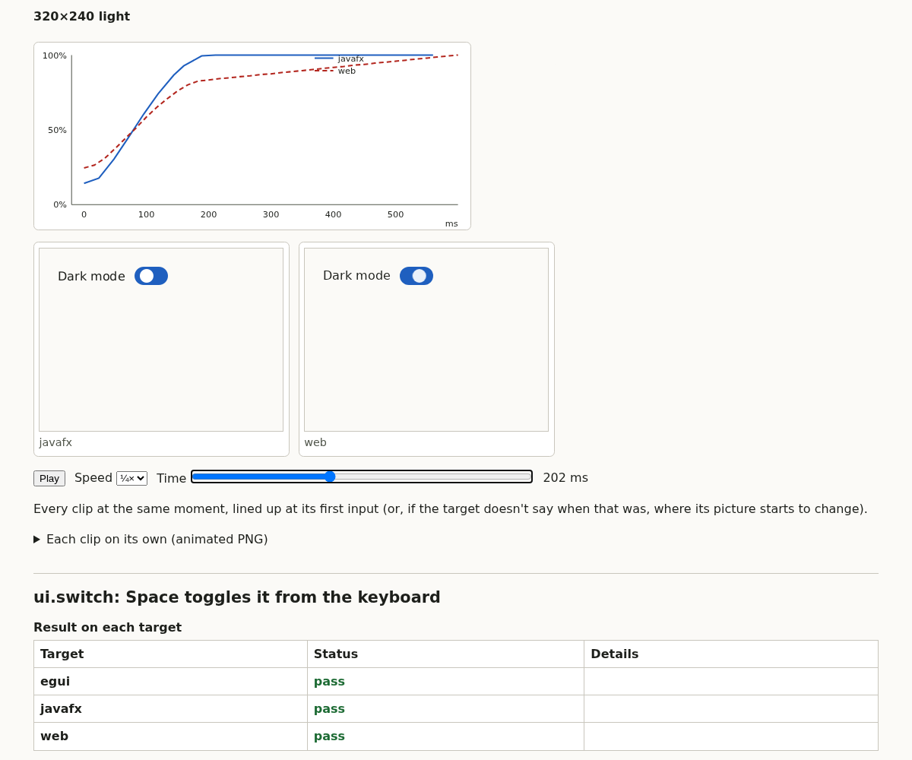

# Motion: comparing what moves, not only where a point goes

The banking stress test animated card lifts, number reveals (a blur fading into text), page
entrances and a frost overlay. omnicui 0.1.0 had two ways to look at motion:

- **Traces** follow one point's position. That works for the card lift. It sees nothing of a fade, a blur or a frost.
- **Clips** recorded every frame, but nothing compared them. They were dithered GIFs taken at the first viewport only, shown as separate loops in the report.

Clips can't simply be compared frame by frame. Each target records on its own clock and from its own moment:

| target | how it records | its frames here |
|---|---|---|
| web | Chromium's screencast: a frame only when the page changes | 17 ms apart while moving; none while still (a 246 ms gap before the first change) |
| JavaFX | a snapshot every pulse | 20–30 ms apart: each snapshot slows the next pulse |
| egui | simulated time | exactly 16.7 ms apart |

## What is done now

1. **Visual progress.** Each clip becomes a 0→1 curve: for every frame, 1 − its distance to the last frame / the first frame's distance to the last. The distance is the mean colour distance over the pixels that change at all in the clip. The curve is then compared like a trace:
   - lined up by the mean difference, which removes each target's start time;
   - measured at 10%, 20%, … 90% of the change, which removes the frame rate.

   The first version read the screencast's 246 ms gap as a slow ramp, and put web and JavaFX 80 ms apart on a correct switch. Frames more than 40 ms apart are now a held picture.
2. **Opacity traces** (`property: opacity`), on web and JavaFX: the part's opacity times its ancestors'. egui multiplies opacity into its painted colours and has nothing to read back. It says so, and its fades are compared through the clip.
3. **Input times.** `record` replies with when each step's input landed, on the frames' clock. report.html uses this to line every target's clip up at the input, in one player.
4. **Lossless clips** (animated PNG), and `allCombinations: true` for traces and clips at every viewport and colour scheme.

## Measured on the real targets

These come from the switch's "a press turns it on" test in `make test-real`, egui included through software Vulkan. Each cell is the largest difference between two targets, in ms.

| run | position trace | clip, visual progress |
|---|---|---|
| no defect (6 runs) | 0.0–0.5 | 0.8–20 |
| `web.switch.slow`: 300 ms linear slide on web | 59 | 73–89 |
| `javafx.switch.linear`: the same on JavaFX | 59 | 96–104 |
| `egui.switch.linear`: the same on egui | 59 | 72–74 |
| `web.switch.dim`: the thumb also fades over 600 ms, web only | **0.3** | **183–184** |
| `javafx.switch.dim`: the same, JavaFX only | **2.3** | **182–184** |

- **The fade is invisible to the position trace and plain in the clip.** That is the case the banking agent had no check for.
- **Clips are noisier than traces,** so they have their own threshold, `thresholds.motion`, at 40 ms by default:
  - correct clips measured up to 20 ms apart, mostly egui against the others;
  - every defect measured 72 ms or more.

An opacity trace, run against the same targets, matches the fade's named timing ("600ms linear") within 0.0 ms on web and 0.1 ms on JavaFX. The target without the fade shows as "one changed and the other didn't".

## Not covered

- **Round trips.** A clip that ends where it started (hover in, hover out) has no direction, and is reported as not measured. Trace a part for it.
- **Clock quality.** Clip timing is only as good as each target's clock. JavaFX's snapshots slow its own frames, which is the main reason clips are noisier than traces.
