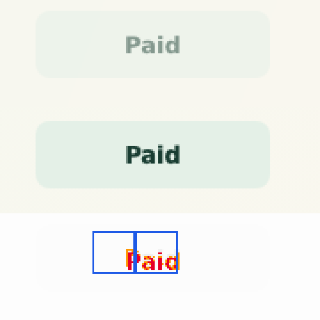
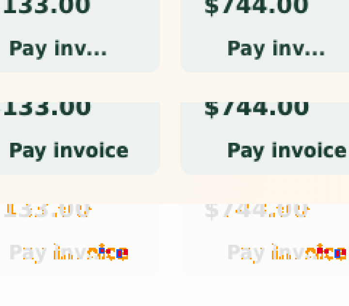
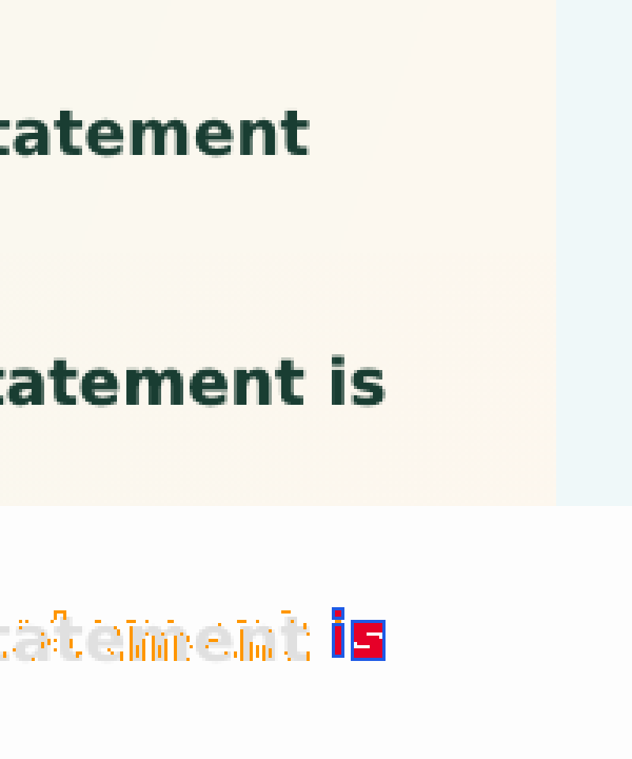
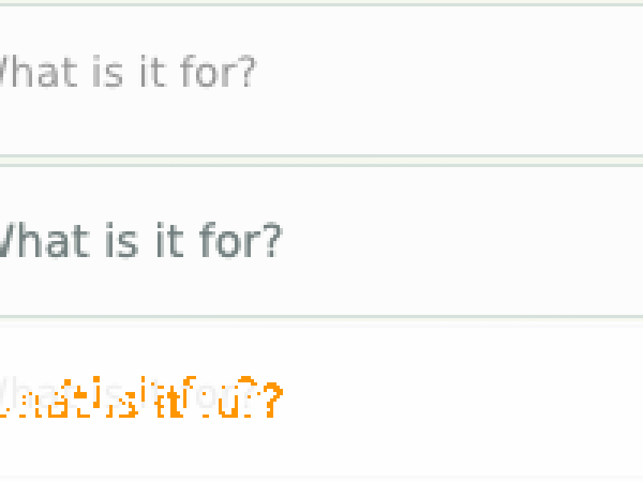

# How the four pixel measures and their defaults were chosen

omnicui 0.1.0 compared screenshots by one number: the share of the drawn area that differs. A
banking app built three times (React, JavaFX, egui) by an agent, on 7 November 2026, showed what
that number can't do. The agent set the threshold to 1%. Its final run had 72 warnings, all between
1.8% and 8.7%, and every one looked the same. At least three of them were real defects, and the
agent found one of them only by sampling pixels by hand.

## The corpora

- **Banking:** 150 screenshot pairs. These are the agent's final run: 26 tests, 2 viewports, the three pairs of targets, on macOS. The corpus also has the screenshots of its invoice test from before it fixed the disabled-button opacity. All of them are in the handoff archive.
- **Reference:** this repository's counter and switch, on Linux with software rendering, in two forms:
  - correct;
  - with the deliberate defects `javafx.host.stretch` and `web.counter.padding`.

Each pair was measured with `omnicui compare a.png b.png --json`. The worst spot of each pair was then looked at in the screenshots themselves.

## What each candidate measure did

Banking, correct pairs (the defects below taken out):

| measure | median | 95th percentile | max |
|---|---|---|---|
| area | 3.2% | 7.7% | 8.7% |
| strength | 15.6% | 16.4% | 16.6% |
| shift | 3 px | 4 px | 4 px |
| spot | 0.35% | 3.1% | 3.1% |

Reference, correct pairs: area 2.5–9.6%, strength 13–20%, shift 3–5 px, spot 0.0%.

The defects:

| defect | where | area | strength | shift | spot |
|---|---|---|---|---|---|
| a paid button at full opacity on web and JavaFX, half on egui | banking, invoices | 3.6–5.8% | 16–17% | 4 px | **9.9–14.6%** |
| JavaFX shortens "Pay invoice" to "Pay inv…" | banking, every compact dashboard | 3–6% | 16% | 3–4 px | **12–14.6%** |
| JavaFX drops the word "is" from a message line | banking, messages | 5.7% | 19% | 4 px | **21.7–22.7%** |
| egui draws input placeholders lighter and smaller | banking, transfer and messages | 3–4% | 15% | 3–4 px | **3.8–5.7%** |
| the component stretched and centred | reference, `javafx.host.stretch` | **100%** | **45–65%** | 0 | **10.6–89%** |
| a wider, taller button | reference, `web.counter.padding` | **74–75%** | **63–65%** | 4 px | **14.6%** |

What the screenshots show:

## What follows

- **Area** separates the reference defects, which are large, but not one banking defect. Every banking defect sits inside the range of correct pages. It stays, unchanged, so that existing thresholds keep their meaning. The default stays at 30%.
- **Strength** averaged over the whole page is dominated by anti-aliased edges, 13–20% everywhere. Small defects don't move it. Large ones go to 45% and over. The default is **25%**.
- **Shift**, measured as the median distance to the nearest match, was 3–5 px for correct pages and for every defect alike. It describes a difference, but it decided nothing in these corpora. The default is **6 px**, above the noise, so that it warns only on a real move. A first version used the 95th percentile, and it was 7–9 px everywhere: anti-aliased pixels often have no match at all.
- **Solid area** was the first idea for the fourth measure: what still differs after peeling one-pixel edges off. It caught the missing word (0.21%) and nothing else, because text strokes are two or three pixels wide and erode away.
- **Spot** measures concentration instead of thickness: the share of the worst 24×24 px square whose pixels differ strongly. A strong difference is a colour distance above 35%, which anti-aliased edges mostly stay under. Correct pages reach at most 3.1%; every defect reaches 3.8% or more, and the major ones 9.9% or more. The default is **3.5%**. Square sizes of 12 and 16 px, and other cut-offs, separated less well.

Nothing else in the run changes: the threshold for each measure is in the contract, and the defaults are in `internal/contract/model.go`.

## Revised once egui could render (the same day)

The reference repository's egui target had taken no screenshots here, since the box had no Vulkan
driver. With Mesa's software driver (lavapipe), unpacked without root, it did, and the correct
reference counter warned. JavaFX draws its button about 3 px wider than egui, and web sits within
the 2 px reach of both. In dark mode those are thin light strokes on a dark ground: strength
measured 44.7% and spot 6.8% on a correct rendering. Shift reached 7 px, and 14 px once its search
went out to 16 px, because anti-aliased pixels find a "match" further away the further you look.

So **strength** and **spot** now leave out displaced pixels: those with a pixel of their colour
within 4 px in the other screenshot. Displacement is what shift describes. **Shift** keeps its
8 px search, and its default is 8 px, the most it measures, so it is shown but doesn't warn on its
own.

The same corpora, measured again:

| | correct, max | defects |
|---|---|---|
| spot, banking | 1.6% | opacity 9.9–14.6%, "Pay inv…" 9.5–12.5%, missing word 21.7–22.7%, egui placeholders 2.4–4.9% |
| spot, reference (egui included) | 0.2% | `egui.render.cursor` 4.5–7.8%, `egui.counter.small-text` 7.6–9.4%, `web.counter.padding` 9.6–10.1%, `javafx.host.stretch` 10.6–90% |
| strength, banking | 19% | 18–30% (spot catches the overlap) |
| strength, reference | 24% | `web.switch.dim` 30–32%, the others 47–68% |
| area, reference | 26% | 37–100% |

**The defaults now:** area 30%, strength 28%, shift 8 px, spot 2%. Every defect above goes over at least one of them, and no correct pair does.
